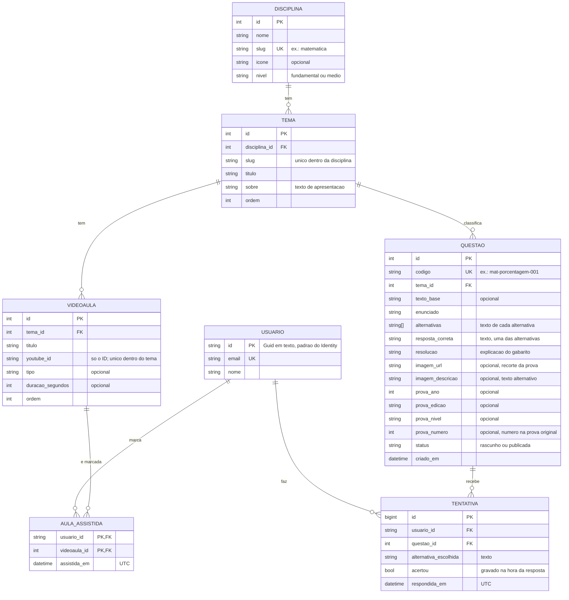

# Modelo de dados: Estudaê

> **Status:** v2 (08/11/2026). Existem as tabelas do Identity (migration `InicialIdentity`) e as
> de conteúdo: `disciplina`, `tema`, `videoaula` e `questao` (migration `Conteudo`).
> `tentativa` e `aula_assistida` continuam só no papel: login e tentativas ficaram fora do MVP.
> As tabelas nascem por migration, uma de cada vez, conforme cada ticket precisar delas.
> O diagrama fica em `ModelodeDados.svg`, que **ainda é o da v1** (sem `codigo`): o bloco Mermaid
> abaixo é a versão atual. Para regerar: colar o bloco em mermaid.live e exportar SVG.
>
> Histórico: v1 (18/10) modelo inicial; adendo (19/10) `questao.status`, `questao.prova_numero`
> e "Convenções de conteúdo"; v2 (08/11) `questao.codigo`, índice único de vídeo por tema,
> escopo do MVP e a migration `Conteudo`; v3 (10/11) `disciplina.nivel`,
> `questao.imagem_descricao` e uso de `questao.imagem_url` (migration `NivelEImagem`).

## O que o sistema guarda

- **Conteúdo** (cadastrado por administradores): disciplinas, temas, vídeo-aulas e questões.
- **Progresso do aluno** (só para quem tem conta): tentativas de questões e aulas assistidas.
- **Visitante** usa o site sem conta e **não grava nada**, então não existe no banco.

## Glossário

| Termo | Significado | Exemplo |
|---|---|---|
| Disciplina | Matéria que o aluno escolhe estudar | Matemática, Português |
| Tema | Assunto dentro de uma disciplina | Porcentagem e proporção, Interpretação de texto |
| Questão | Pergunta de múltipla escolha de uma prova anterior | |
| Vídeo-aula | Vídeo do YouTube ligado a um tema | |
| Tentativa | Uma resposta dada por um aluno a uma questão | |

## Diagrama

> `USUARIO` é a tabela `usuario` (Identity). Os papéis **Administrador** e **Aluno**
> usam as tabelas de papéis do próprio Identity, por isso não aparecem no diagrama.

## Entidades

**Disciplina:** o que o aluno escolhe estudar. O `slug` é um nome estável e único (`matematica`),
usado pelo importador de conteúdo no lugar do `id`.

**Tema:** pertence a uma disciplina. Tem texto de apresentação (`sobre`) e `ordem` de exibição.

**Videoaula:** pertence a um tema. Guardamos **só o ID do YouTube** (11 caracteres); o player é
montado com `https://www.youtube-nocookie.com/embed/{youtube_id}`. O vídeo em si nunca é hospedado
por nós. O par (`tema_id`, `youtube_id`) é único: é a chave que o importador usa para atualizar um
vídeo já cadastrado em vez de duplicá-lo.

**Questão:** pertence a um tema (a disciplina é descoberta pelo tema, sem ligação direta).
Principais campos:
- `codigo`: chave natural e única, legível por gente (`mat-porcentagem-001`). É por ela que o
  importador reconhece uma questão que já existe: reimportar o mesmo código **atualiza**, não
  duplica. O `id` continua sendo a chave usada nas FKs e na API.
- `texto_base` (opcional) e `enunciado`: o texto de apoio e a pergunta em si.
- `alternativas` e `resposta_correta`: o **texto** de cada alternativa, e o texto da certa.
- `resolucao`: explicação de como se chega à resposta.
- `prova_ano`, `prova_edicao`, `prova_nivel`: só a origem da questão (ex.: "Encceja 2019, Médio").
  Todos opcionais, porque a prova inteira nunca é exibida ao aluno.
- `prova_numero` (opcional): o número da questão na prova original, para conferir a questão
  contra o PDF durante a revisão.
- `status`: `rascunho` ou `publicada` (com `CHECK` no banco). O site **só mostra questões
  publicadas**. Enquanto não há área admin, a revisão acontece **no arquivo JSON**, no PR, feita
  por outra pessoa. O importador grava como `rascunho` por padrão e como `publicada` só com a
  flag `--publicar`.

**Tentativa:** cada resposta dada por um aluno. **Todas** são guardadas, inclusive repetições
da mesma questão. O desempenho (% de acertos por tema ou disciplina) é **calculado** a partir daqui.

**Aula assistida:** liga um aluno a uma vídeo-aula que ele marcou como vista.

**Usuário:** a tabela `usuario` (Identity). `email` e o `id` vêm do Identity; `nome` **não é
coluna padrão do Identity**: é uma propriedade nossa numa classe de usuário que estende
`IdentityUser`.

## Tabelas do Identity

Para seguir a regra de nomes em português, as tabelas do Identity são mapeadas para nomes
próprios, em vez dos nomes que a convenção de `snake_case` geraria (`asp_net_users` etc.).
O mapeamento está em `Estudae.Infra/Persistence/EstudaeDbContext.cs` e entrou na primeira
migration (`InicialIdentity`).

| Tabela do Identity | Nome no banco |
|---|---|
| `AspNetUsers` | `usuario` |
| `AspNetRoles` | `papel` |
| `AspNetUserRoles` | `usuario_papel` |
| `AspNetUserClaims` | `usuario_claim` |
| `AspNetUserLogins` | `usuario_login` |
| `AspNetUserTokens` | `usuario_token` |
| `AspNetRoleClaims` | `papel_claim` |

- **As sete tabelas ficam, mesmo as que ainda não usamos.** Isso foi verificado com um
  experimento (fase 3), tirando cada grupo do modelo com `Ignore<>()`. Em nenhum caso o modelo
  ou o cadastro quebram. O erro aparece **só em tempo de execução**, quando alguma funcionalidade
  usa a tabela que falta (`Cannot create a DbSet for '...'`):

  | Tabela removida | O que quebra |
  |---|---|
  | `usuario_claim` | **Todo login**: montar o cookie lê as claims do usuário |
  | `usuario_papel` / `papel` / `papel_claim` | **Todo login** (o cookie também leva os papéis) e `AddToRole` |
  | `usuario_token` | Autenticação em dois fatores (chave do autenticador) |
  | `usuario_login` | Login externo (Google etc.) |

  Ou seja, tirar claims ou papéis quebra o básico; tirar tokens ou logins cria uma falha
  escondida que só aparece quando alguém ligar 2FA ou login externo. Uma tabela vazia custa
  quase nada, então todas ficam. (O caminho suportado para não ter as tabelas de papéis seria
  herdar de `IdentityUserContext`, mas nós usamos papéis.)
- Só os **nomes das tabelas** são traduzidos. As **colunas** do Identity ficam com os nomes
  dele em `snake_case` (`password_hash`, `normalized_email`, `security_stamp`...). Traduzir
  coluna por coluna dá muita configuração para pouco ganho. Essa é a única exceção à regra
  de nomes em português.
- O Identity dá nomes fixos a três índices (`EmailIndex`, `UserNameIndex`, `RoleNameIndex`), e a
  convenção de `snake_case` não alcança esses nomes. Eles foram renomeados no DbContext para
  `ix_usuario_normalized_email`, `ix_usuario_normalized_user_name` e `ix_papel_normalized_name`.
- `usuario.nome` é `varchar(150)`, obrigatório.
- A tabela de controle das migrations mantém o **nome** padrão do EF, `__EFMigrationsHistory`,
  mas as **colunas** passam pela convenção de `snake_case`: `migration_id` e `product_version`
  (e não `MigrationId`/`ProductVersion`). Isso importa para quem consultar a tabela à mão.

## Decisões e motivos

| Decisão | Motivo |
|---|---|
| Não existe tabela `Area`; "área" = disciplina | O produto só tem uma hierarquia; dá pra agrupar depois com uma coluna |
| Não existe tabela `Prova`; ano, edição e nível ficam na questão | O aluno nunca vê a prova inteira, só a origem de cada questão |
| Vídeos ligados só ao tema | Vídeo por questão fica para o futuro; adicionar depois é uma migration simples |
| Alternativas como lista de textos dentro da questão | Simplicidade, e permite embaralhar a ordem na exibição |
| Tentativa guarda o **texto** escolhido, não a posição | Combina com o embaralhamento; a ordem das alternativas não importa |
| `acertou` gravado na tentativa | O histórico não muda se o texto da questão for editado depois |
| Guardar todas as tentativas | Permite ver evolução; o custo de armazenamento é baixo |
| Só Ensino Médio por enquanto | Nível entra como atributo opcional, preparado para crescer |
| Questão com `status` (`rascunho`/`publicada`) | Rascunhos extraídos com ajuda de IA precisam de revisão humana antes de chegar ao aluno |
| `questao.codigo` único | Sem uma chave natural, rodar o importador duas vezes duplicaria tudo; o `id` muda entre ambientes |
| Vídeo único por (`tema_id`, `youtube_id`) | Mesmo motivo, para os vídeos |
| FKs de conteúdo com `ON DELETE RESTRICT` | Apagar um tema com questões dá erro, em vez de levar as questões junto sem aviso |
| Chaves `int` no conteúdo, `bigint` em tentativas, padrão do Identity no usuário | Simples e legível; dados pessoais protegidos por dono, não por segredo |

## Regras e cuidados

- **Alternativas:** os textos devem ser **únicos dentro da questão**, e `resposta_correta` deve ser
  **exatamente igual a uma delas**. Validar isso no cadastro e no importador.
- **Embaralhar:** só é seguro se nenhuma alternativa se referir a outra por posição
  ("as alternativas A e B estão corretas"). Se isso aparecer, a questão precisa de tratamento à parte.
- **Dados do aluno:** todo endpoint de tentativas e aulas assistidas filtra pelo **usuário logado**,
  nunca pelo id que vem na URL.
- **Importador de conteúdo:** referencia disciplina e tema pelo `slug`, para o mesmo arquivo funcionar
  em desenvolvimento e em produção, onde os `id` serão diferentes.
- **Datas** sempre em UTC.

## Convenções

- Nomes de tabelas e colunas **em português, sem acentos**.
- No banco, `snake_case` (`tema_id`); no C#, `PascalCase` (`TemaId`). O mapeamento é automático
  com o pacote `EFCore.NamingConventions`.
- Cada mudança no modelo é uma **migration nova**; migrations já aplicadas em outro ambiente
  nunca são editadas.
- Este documento e o diagrama são atualizados **no mesmo commit** da migration.

## Convenções de conteúdo

- **Fluxo de importação (MVP):** o texto da questão é extraído do PDF da prova, com ajuda de IA
  no chat, para o formato JSON do importador; uma pessoa revisa o JSON no PR (resolvendo de novo
  as de Matemática); o **importador em C#** valida e grava. Formato, validações e comandos: `conteudo/README.md`.
- **Fluxo planejado (depois do MVP):** um script em **Python** extrai os rascunhos dos PDFs com
  IA, fora da aplicação publicada, e o importador continua sendo a porta de entrada.
- **Fonte:** toda questão do INEP leva `prova_ano`, `prova_edicao`, `prova_nivel` e
  `prova_numero`, exibidos ao aluno como citação da fonte. Os quatro são **tudo ou nada**
  (10/11/2026): sem nenhum, a questão é **autoral** (escrita pela equipe) e aparece como
  "Questão autoral Estudaê"; origem pela metade é recusada pelo importador. Sem mudança de
  schema: as colunas já eram anuláveis.
- **Matemática** é escrita em **LaTeX** dentro das colunas de texto (`enunciado`,
  `alternativas`, `resolucao`) e renderizada no frontend com **KaTeX**.
- **Delimitadores:** `\( ... \)` para fórmula na linha e `\[ ... \]` para fórmula em
  bloco. **Não usar `$`**, porque as questões têm valores como "R$ 10,00".
- Preferir `\dfrac` a `\frac` no meio do texto: a fração fica maior e mais fácil de ler.
- **Figuras, tabelas e gráficos** entram como imagem (decidido em 10/11/2026): `imagem_url`
  guarda o caminho do **recorte da questão na prova**, relativo a `conteudo/imagens/` (servido
  pela API em `/conteudo/imagens/`), e `imagem_descricao` o texto alternativo, obrigatório
  quando há imagem. Uma imagem por questão. Questão com imagem não tem as alternativas
  embaralhadas, porque o recorte mostra as letras originais.
- **Nível:** `disciplina.nivel` separa as provas de Ensino Fundamental e Médio. A mesma matéria
  nos dois níveis são duas disciplinas (`matematica` e `matematica-fundamental`).
- **Usar o mínimo de LaTeX:** `5²`, `×` e `R$ 10,00` em texto puro bastam na maioria das questões,
  e a leitura em voz alta lê texto puro direito.

## Escopo do MVP

- Ensino Médio, Português e Matemática, questões de provas do INEP sem figura nem tabela.
- Quatro temas por disciplina (ajustáveis só no JSON de conteúdo):
  - **Português:** `interpretacao-de-texto`, `generos-textuais`, `variacao-linguistica`, `gramatica`.
  - **Matemática:** `porcentagem-e-proporcao`, `equacoes`, `geometria-plana`, `estatistica-basica`.
- Quiz por tema. Sem login e sem gravação de tentativas: `tentativa` e `aula_assistida` ficam
  para depois.

## Fora do escopo agora

- **Contato de um responsável** (a tela de cadastro tem um campo `guardian`): é dado pessoal
  de uma terceira pessoa, com implicações na LGPD, então só deve ser coletado se houver um uso
  claro para ele. Fica para depois.

## Pontos a confirmar

- [ ] `videoaula.tipo`: a tela precisa distinguir tipos (introdutório, aprofundando...) ou isso pode sair?
- [ ] `aula_assistida`: basta marcar uma vez por aluno (modelo atual), ou queremos histórico de cada vez que ele assiste?
- [x] `questao.imagem_url`: recortes versionados em `conteudo/imagens/` e servidos pela API (10/11/2026).
- [ ] `prova_edicao`: texto ou número? Conferir como o INEP identifica as edições.
- [ ] Termos de uso das provas do INEP para reaproveitar as questões.